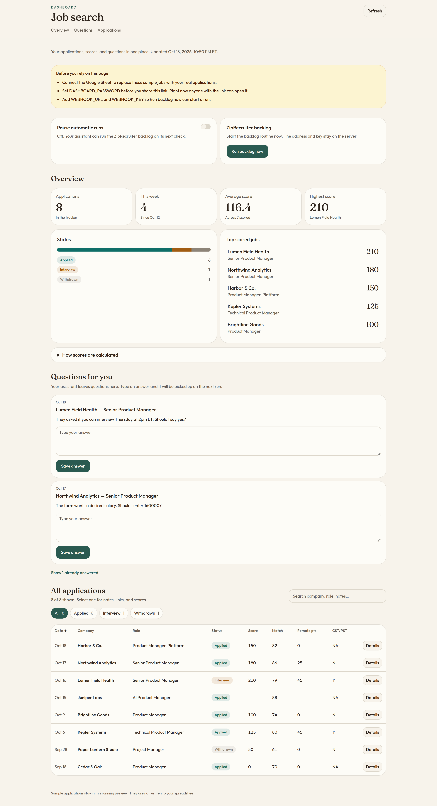

# Job search dashboard

**Genevieve Mitchell** · Senior / AI Product Manager



## The problem

A high-volume job search does not fit in a browser tab. Roles show up all day. Each one has to be scored against rules I already decided, and the strong ones should go out without me sitting in the form. I still need to see what went out, stop a run when I want, and answer the questions that only I can answer.

## The system

AI agents search and score ZipRecruiter jobs, then auto-apply to strong matches under rules I defined. Every application is logged to a Google Sheet. When an agent hits something it should not guess — an interview time, a salary figure, a form question — it writes that question to the sheet and waits.

## What the dashboard adds

The sheet is the record. The dashboard is how I look at it and talk back.

- **Visibility.** Totals, applications from this week, the status mix, the average desirability score, the highest-scoring roles, and a searchable table with the notes behind each row.
- **Run now.** A button asks the server to call the backlog webhook. The address and the secret never reach the browser.
- **Pause.** A switch writes a boolean the agent reads before the next run. I can stop automatic applies without opening another tool.
- **Questions, asynchronously.** Open questions from the sheet show up on the page. I answer when I have a minute. The answer is written back, and the agent picks it up on its next run. This is not a live chat.

## Product decisions and tradeoffs

**The sheet stays the system of record.** I did not add a second database. The agents, the dashboard, and I all read and write the same workbook. A spreadsheet is not a perfect app database: two writes can race, and the last write wins. That is acceptable here. One person is answering, and the agents run in batches.

**Columns are found by header name.** The Applications tab can be rearranged. The dashboard looks up Company, Status, Desirability Score, and the rest by the text in the header row, not by column letter. Inserting a column does not break it. Renaming a header does. I preferred that tradeoff.

**Pause is a cell, not a service.** On the Dashboard Control tab, A1 is the label and B1 is TRUE or FALSE. The agent checks that cell. There is no queue and no feature-flag vendor. Pause is only as fresh as the next time the agent looks.

**Questions are rows, not a chat thread.** Pending Questions is Date, Job/Company, Question, Answer, and Status (`Open` or `Answered`). A blank status counts as open. I answer on the dashboard. The agent reads `Answered` rows later. I gave up instant back-and-forth so I would not have to be online while the agent is running.

**The webhook secret stays on the server.** Run now is a server POST. The header name, and whether the key is sent as a bearer token, a raw header, or a JSON field, are settings. I did not want to rebuild the agent endpoint to match the dashboard. A deployed site requires https.

**One shared password, not accounts.** This is a single-operator tool. A password cookie is enough, and there is no user table. If the password is unset, the page stays open and says so. That is useful on my own machine, and the wrong setting for a shared link.

**Sample mode when Google is not connected.** With no service-account credentials, the page shows fictional applications so the interface can be reviewed. Those rows are never written to a sheet. Once credentials are set, `SPREADSHEET_ID` is required. Nothing in the code points at a default spreadsheet.

## Tech stack

- Next.js (App Router) and React
- TypeScript
- Tailwind CSS
- shadcn/ui
- Google Sheets API, through a service account
- Vercel for hosting. The Hobby plan is enough when the repo is imported from GitHub.

## Setup

### Run it locally

1. Install [Node.js](https://nodejs.org) 20 or newer.
2. In this folder, install dependencies:

   ```bash
   npm install
   ```

3. Copy the example settings:

   ```bash
   cp .env.example .env.local
   ```

4. Start the app:

   ```bash
   npm run dev
   ```

5. Open [http://localhost:4177](http://localhost:4177).

Leave the Google settings blank to see the sample applications in the screenshot. `npm test` runs the parser and webhook checks.

### Settings

Put these in `.env.local` on your computer, and in Vercel’s environment variables when you deploy. Do not commit real values.

| Name | Required | What it is |
| --- | --- | --- |
| `DASHBOARD_PASSWORD` | Yes, before you share the link | Password for the page. If this is empty, anyone with the link can open it. |
| `GOOGLE_SERVICE_ACCOUNT_JSON` | Yes, to read a real sheet | The whole service-account key file, pasted as one value. |
| `GOOGLE_SERVICE_ACCOUNT_EMAIL` | Only if you skip the JSON value | The `client_email` field from the key file. |
| `GOOGLE_PRIVATE_KEY` | Only if you skip the JSON value | The `private_key` field from the key file. Keep the `\n` characters. |
| `SPREADSHEET_ID` | Yes, once Google credentials are set | The id in the spreadsheet URL, between `/d/` and `/edit`. |
| `WEBHOOK_URL` | Yes, for Run now | Server-side address that starts the backlog routine. |
| `WEBHOOK_KEY` | Yes, for Run now | Server-side secret for that call. |
| `WEBHOOK_KEY_HEADER` | No | Header that carries the key. Default: `Authorization`. Use `none` to skip the header. |
| `WEBHOOK_KEY_SCHEME` | No | Prefix for the key. Default: `Bearer`. Use `raw` to send the key alone. |
| `WEBHOOK_KEY_BODY_FIELD` | No | If set, the key is also placed in the JSON body under this field name. |

The browser never receives `WEBHOOK_URL` or `WEBHOOK_KEY`.

- Default: an `Authorization` header using the `Bearer` scheme. Leave the optional webhook settings as they are in `.env.example`.
- A custom header with the key alone: set `WEBHOOK_KEY_HEADER` to the header name and `WEBHOOK_KEY_SCHEME` to `raw`.
- The key in the JSON body instead of a header: `WEBHOOK_KEY_HEADER=none` and `WEBHOOK_KEY_BODY_FIELD` set to the field name.

On a deployed site the webhook address must start with `https://`.

### Connect a Google Sheet

The dashboard signs in as a service account, not as a person. Share the sheet with that account as an Editor so the pause switch and answers can be written.

1. Open [Google Cloud Console](https://console.cloud.google.com/) and create a project. A name like `Job search dashboard` is fine.
2. In that project, open **APIs & Services → Library**, find **Google Sheets API**, and enable it.
3. Open **APIs & Services → Credentials**. Click **Create credentials → Service account**. Name it `job-dashboard`, then finish.
4. Open the **Keys** tab. Click **Add key → Create new key → JSON**. A file downloads. That file is the credential. Do not commit it.
5. In the JSON, copy `client_email`. It ends with `.iam.gserviceaccount.com`.
6. Open your spreadsheet, click **Share**, paste that client email, and set the role to **Editor**.
7. Copy the spreadsheet id from the sheet URL into `SPREADSHEET_ID`.
8. Paste the entire JSON file into `GOOGLE_SERVICE_ACCOUNT_JSON`. Keep it as one value, curly braces included. Pasting the file as-is keeps the private key intact.

If pasting the whole file is awkward, use the two fields instead. `GOOGLE_SERVICE_ACCOUNT_EMAIL` is the `client_email` value. `GOOGLE_PRIVATE_KEY` is the `private_key` value, including the begin and end markers. On one line, keep `\n` where the line breaks were.

Restart `npm run dev` after you change `.env.local`.

The page reads an **Applications** tab by the names in the header row. That row can sit below a title. Column letters can change. It looks up Company, Job Title, Status, Desirability Score, Match Score, and the other headers by name. A **Scoring** tab, when present, is shown under “How scores are calculated.”

**Dashboard Control** is created if it is missing. Cell A1 says `Paused`. Cell B1 is `TRUE` or `FALSE`. The agent should read B1 before a ZipRecruiter run and skip the run when it is true.

**Pending Questions** is created if it is missing. The columns are Date, Job/Company, Question, Answer, and Status. The agent adds a row and sets Status to `Open`. Saving an answer writes the Answer cell and sets Status to `Answered`. A blank Status is still open. The agent should read Answer on rows whose Status is `Answered`.

### Deploy on Vercel

The Hobby plan works when the project is imported from GitHub.

1. Push this project to GitHub.
2. Go to [vercel.com/new](https://vercel.com/new) and import it. The framework should be Next.js. Leave the build command as `npm run build`.
3. Add the variables from the table for Production (and Preview, if preview links should be locked too).
4. Set `DASHBOARD_PASSWORD` to a password you do not use anywhere else.
5. Deploy. The site should ask for the password, then show the sheet.
6. If you still see sample jobs, the Google variables are missing or were not applied. Add them and redeploy.
7. If Google refuses access, share the sheet with the service account as Editor. The page shows that client email when it has one.

After the first deploy, Vercel redeploys when you push. Changing a variable needs a new deploy before the live site picks it up.
